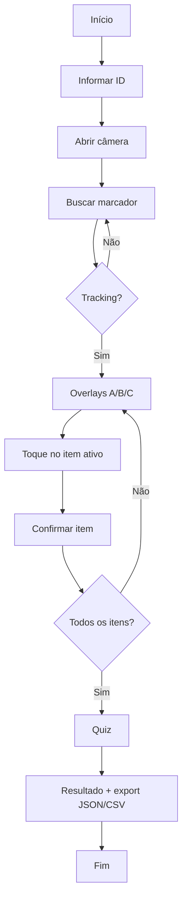

# SafetyLens

> **ODS Vision — SafetyLens** · UPX: Realidade Aumentada · UniFacens  
> Treinamento de segurança e identificação de riscos industriais via smartphone (Image Tracking).


%20%7C%20Android%20(ARCore)-blue)


**Repositório:** [github.com/JoaoLops3/ODS-Vision-SafetyLens](https://github.com/JoaoLops3/ODS-Vision-SafetyLens)  
**Modelo de documentação:** [dr-ohata/upx-modelo](https://github.com/dr-ohata/upx-modelo)

---

## 1. Identificação do Projeto

| Item | Informação |
|---|---|
| **Projeto** | SafetyLens (ODS Vision) |
| **Equipe** | ODS Vision — SafetyLens |
| **Curso** | Engenharia de Computação |
| **Disciplina** | UPX — Realidade Aumentada |
| **Professor** | Prof. Daniel Domingos Akira de Sá Pimentel Ohata |
| **Semestre** | 2026.2 (8º semestre) |
| **Instituição** | UniFacens — Sorocaba, SP |

### Integrantes

| Nome | RA | E-mail | Responsabilidade |
|---|---|---|---|
| Brunno Eduardo Marfil Marins | 236051 | bruno.marfil@hotmail.com | Desenvolvedor AR — integração AR Foundation / marcadores (Image Targets) |
| Bruno Romi Cervone | 235212 | brunoromicr@gmail.com | Engenharia de Software e testes de usabilidade — testes funcionais, validação da persistência local e protocolo da escala SUS |
| Giovane Zanzarini Iano | 236082 | giovanezanza@gmail.com | Front-end, UI/UX e Design 3D — telas no Unity, menus do quiz e elementos visuais de risco |
| Hector Silveira Colchiesqui | 235354 | colchiesquihector@gmail.com | Arquitetura de sistema e modelagem 3D/assets — EPIs, Image Targets e organização das camadas do sistema |
| João Gabriel Lopes Aguiar | 223969 | joaogabriellops2353@gmail.com | Gestão de projeto e documentação — Kanban/Trello, cronograma ágil, documentação técnica e apoio em interações front-end |
| Luis Alberto Sant'Anna de Araújo | 236401 | Santannaluis10@gmail.com | Pesquisa científica e análise de dados — métricas (cronometragem, erros) e tratamento estatístico do experimento |
| Miguel Muran Zvir Novaes | 222674 | muranmiguel@gmail.com | Redação principal e metodologia — fundamentação teórica, delineamento experimental e padronização do artigo |

Artigo científico da equipe: [`docs/documents/SafetyLens-Artigo-Cientifico.pdf`](docs/documents/SafetyLens-Artigo-Cientifico.pdf).

### Artigos científicos utilizados como base

Planilha completa (fonte da tabela abaixo):

- [Excel no SharePoint (Facens)](https://facens-my.sharepoint.com/:x:/g/personal/223969_facens_br/IQD6DAxNHPhGSaIQRpkXLhdFAZtFv9VKDNwsFKHG7cuFfUY?e=43COmv)
- Cópia no repositório: [`docs/documents/Tabela_Artigos_Cientificos_SafetyLens_UPX8.xlsx`](docs/documents/Tabela_Artigos_Cientificos_SafetyLens_UPX8.xlsx)

| ID | Integrante responsável | Título do artigo | Autores | Ano | Fonte / periódico / evento | Objetivo do estudo | Metodologia | Principais resultados | Limitações apontadas | Contribuição para o SafetyLens (relação com o projeto) |
|---|---|---|---|---|---|---|---|---|---|---|
| 1 | João Gabriel | Treinamentos utilizando a Realidade Aumentada e Virtual: comparação da inovação e tradicionalismo na formação profissional | BORGES, P. R. et al. | 2019 | IX CIKI (Congresso Internacional de Conhecimento e Inovação) | Avaliar os impactos do uso de tecnologias imersivas (RA e RV) em treinamentos operacionais e corporativos. | Estudo comparativo e exploratório sobre engajamento e usabilidade em ambientes de formação. | Comprovou aumento significativo no engajamento, na retenção de conteúdo e na segurança operacional. | Custos iniciais de infraestrutura e barreiras técnicas de adoção. | Fundamenta a necessidade de interfaces ativas para treinamento e monitoramento de riscos. |
| 2 | Brunno Marfil | BIM-based immersive virtual reality for construction workspace planning: a safety-oriented approach | GETULI, V. et al. | 2020 | Automation in Construction | Investigar a integração de ambientes imersivos no planejamento de segurança e prevenção de riscos operacionais. | Estudo experimental aplicado com simulação de cenários de trabalho e medição de tempos de capacitação. | Prevenção orientada à segurança com redução expressiva no tempo de capacitação dos colaboradores. | Foco restrito a espaços de construção fechados e complexidade de integração. | Fornece a base metodológica de métricas para treinamentos imersivos focados em segurança do trabalho. |
| 3 | Giovane Iano | Uso de realidade virtual e aumentada no ensino de segurança do trabalho na graduação | FAZINGA, W. R.; LUCENA, A. F. E.; SAFFARO, F. A. | 2019 | XI SIBRAGEC (Simpósio Brasileiro de Gestão e Economia da Construção) | Analisar a eficácia do uso de RA e RV na retenção de diretrizes e normas de segurança do trabalho. | Estudo experimental comparativo com aplicação de avaliações práticas antes e após o uso das ferramentas. | Constatação de maior absorção de normas de segurança e aumento na identificação de perigos. | Tempo elevado exigido para modelagem tridimensional prévia dos cenários. | Ampara a substituição dos manuais 2D estáticos por componentes virtuais interativos no SafetyLens. |
| 4 | Bruno Romi | Arquitetura de sistemas para detecção de perigos com IoT e Realidade Aumentada | MURTA, A.; SILVA, B. | 2024 | XVI SBCUP (Simpósio Brasileiro de Computação Ubíqua e Pervasiva) | Propor aprimoramentos para a segurança na Indústria 4.0 conectando sensores IoT e Realidade Aumentada. | Proposição de arquitetura de software e testes de sistema para emissão de alertas em tempo real. | Emissão contínua de alertas preventivos antes do contato do operador com fontes de risco físico. | Latência de comunicação de rede e complexidade de integração com sensores de campo. | Subsidia a estrutura lógica de disparo de alertas de risco e futuras expansões sensoriais do SafetyLens. |
| 5 | Hector Colchiesqui | Realidade virtual aplicada à segurança do trabalho na construção civil: uma revisão sistemática da literatura | NETO, L. et al. | 2022 | Revista Educ@ / SciELO | Mapear como as tecnologias virtuais e imersivas estão sendo aplicadas para treinar a percepção de risco ocupacional. | Revisão Sistemática da Literatura (RSL) em bases científicas nacionais e internacionais. | Constatação de que simulações capacitam a percepção de risco sem expor o trabalhador ao perigo físico real. | Dependência de óculos imersivos de alto custo e equipamentos pesados de processamento. | Justifica a escolha técnica do SafetyLens em rodar via smartphones comerciais acessíveis (democratização do acesso). |
| 6 | Luís Alberto | Usos e benefícios da Realidade Aumentada na Indústria 4.0 | SILVA, M. P. et al. | 2022 | Revista Brasileira de Mecatrônica (v. 4, n. 4) | Investigar as aplicações práticas e ganhos operacionais da sobreposição de informações por RA em ambientes industriais. | Artigo de revisão e estudo de caso aplicado em linhas operacionais assistidas. | Melhorias na precisão de montagem, redução de falhas humanas e suporte em tempo real com mãos livres. | Dependência de conexão de rede estável e curva de adaptação dos operadores à interface. | Fundamenta a sobreposição de instruções de EPIs e alertas de peças móveis diretamente sobre a imagem da máquina. |
| 7 | Miguel Muran | The application of augmented reality technologies for the improvement of occupational safety in an industrial environment | TATIC, D.; TESIC, B. | 2017 | Computers in Industry (v. 85, p. 1–10) | Investigar empiricamente o impacto da RA na diminuição de erros e velocidade de resposta a riscos industriais. | Estudo experimental com implementação e testes de protótipo de RA em ambiente fabril real. | Comprovação estatística de redução na ocorrência de erros operacionais e aceleração na detecção de zonas de risco. | Restrições de capacidade gráfica dos dispositivos móveis e necessidade de calibrar as interfaces. | Valida internacionalmente a hipótese central do SafetyLens de que a RA mitiga falhas humanas e otimiza o tempo de resposta. |

---

## 2. Visão Geral

O **SafetyLens** é um protótipo móvel de Realidade Aumentada para **treinamento de segurança** e **identificação de riscos industriais**. O problema tratado é a alta carga cognitiva dos treinamentos tradicionais baseados em manuais 2D: o trabalhador alterna atenção entre o papel e a máquina real, o que favorece erros de percepção e habilidade.

O público são operadores industriais, técnicos de segurança e estudantes em formação. A solução usa o **smartphone** (sem óculos de alto custo): o participante aponta a câmera para um **marcador** (Image Target) afixado no equipamento; o app sobrepõe placas de alerta e EPIs no contexto espacial, guia a inspeção na ordem correta, aplica um quiz e exporta métricas (tempo, erros, respostas) em JSON/CSV **offline**.

A RA participa como **camada de ancoramento espacial**: um único `ARTrackedImage` rastreia a placa física (~20 cm); HOT, PINCH e EPI são filhos locais nas letras **A / B / C** da arte (âncoras UV), alinhados à pose do ARKit/ARCore via AR Foundation.

---

## 3. Problema

**Contexto.** Na Indústria 4.0, capacitação e segurança do trabalho são prioridades alinhadas aos ODS 4.4 e 8.8. Treinamentos ainda dependem fortemente de manuais impressos e materiais 2D.

**Situação atual.** O operador precisa transferir conhecimento do papel para o maquinário 3D, alternando o olhar várias vezes. Essa alternância eleva a carga cognitiva e aumenta a chance de falhas humanas.

**Dificuldade.** Soluções imersivas com óculos dedicados existem, mas têm custo e barreira de adoção altos para muitas empresas.

**Público afetado.** Operadores, técnicos de SST e instituições de formação técnica/engenharia.

**Impacto.** Erros de identificação de risco e EPI inadequado contribuem para acidentes; falta um método ativo, acessível e mensurável (tempo, erros, retenção) via smartphone.

---

## 4. Objetivos

### 4.1 Objetivo Geral

Desenvolver e validar um protótipo móvel de Realidade Aumentada (**SafetyLens**) que apoie a identificação de riscos industriais e a fixação de conhecimento com coleta automática de métricas.

### 4.2 Objetivos Técnicos

- Implementar reconhecimento de imagens (Image Tracking) com AR Foundation.
- Sobrepor placas de alerta e modelo 3D de EPI ancorados ao marcador (letras A/B/C).
- Permitir interação por toque nos overlays (RF03) e quiz de fixação.
- Cronometrar a sessão e registrar erros (RF04 / RF05).
- Exportar dados locais em JSON/CSV (RF06) sem rede (RNF05).
- Executar e testar em dispositivo móvel (iOS com ARKit; Android com ARCore previsto).
- Documentar instalação, execução, testes e limitações no GitHub.

---

## 5. Público-Alvo

| Aspecto | Descrição |
|---|---|
| **Perfil** | Operadores industriais, técnicos de segurança do trabalho, estudantes de engenharia/formação técnica |
| **Contexto** | Treinamento / inspeção guiada junto a um equipamento com marcador físico |
| **Necessidades** | Ver o risco **no lugar** da máquina; registrar desempenho; baixo custo de hardware |
| **Limitações** | Precisa de smartphone com ARKit ou ARCore; iluminação e visibilidade do marcador |
| **Familiaridade** | Uso básico de smartphone; instrução inicial em menos de 2 minutos (RNF04 do artigo) |

Materiais complementares (persona, jornada): pasta [`docs/documents/`](docs/documents/).

---

## 6. Funcionalidades

| ID | Funcionalidade | Descrição | Status |
|---|---|---|---|
| RF01 | Rastreamento de imagem | Identifica o Image Target (`SafetyLensEquipmentTarget`) via `ARTrackedImageManager` | ✅ |
| RF02 | Exibição de conteúdo em RA | Placas HOT/PINCH e capacete EPI filhos do marcador (UV A/B/C) | ✅ |
| RF03 | Interação por toque | Toque no overlay do item ativo + confirmação; toque errado conta erro; quiz | ✅ |
| RF04 | Cronometragem | Tempo do reconhecimento do marcador ao fim do quiz | ✅ |
| RF05 | Registro de erros | Contabiliza seleções e respostas incorretas | ✅ |
| RF06 | Exportação local | JSON + CSV em `persistentDataPath`; histórico e share iOS | ✅ |
| RF07 | Câmera sob demanda | `ARSession` só ativa após “Abrir câmera” | ✅ |
| RF08 | Histórico de sessões | Lista e reexporta sessões salvas no aparelho | ✅ |
| RF09 | Share Android nativo | Intent de compartilhamento | ⬜ |
| RF10 | Experimento SUS / retenção 7 dias | Módulo completo do protocolo do artigo | 🚧 |

**Legenda:** ✅ Implementado · 🚧 Em desenvolvimento · ⬜ Planejado · ❌ Cancelado

---

## 7. Requisitos Não Funcionais

| ID | Categoria | Requisito |
|---|---|---|
| RNF01 | Compatibilidade | Smartphones convencionais Android 8+ (ARCore) / iOS (ARKit), sem LiDAR obrigatório |
| RNF02 | Desempenho | Meta ≥ 30 FPS durante a experiência RA |
| RNF03 | Estabilidade | Manter ancoramento sob variações moderadas de iluminação |
| RNF04 | Usabilidade | Fluxo compreensível com instrução breve |
| RNF05 | Offline | RA e gravação de dados sem internet |
| RNF06 | Privacidade | Sem conta/nuvem; ID higienizado; descrição de uso da câmera no iOS |
| RNF07 | Documentação | Repositório permite configurar e executar o projeto |

---

## 8. Tecnologias Utilizadas

| Tecnologia | Versão | Utilização |
|---|---|---|
| Unity | **6000.3.0f1** (6.3 LTS) | Engine principal (Built-in Render Pipeline) |
| C# | compatível com Unity 6 | Scripts de sessão, UI, persistência, RA |
| AR Foundation | **6.3.5** | `ARTrackedImageManager`, sessão, câmera |
| Apple ARKit XR Plugin | **6.3.5** | Image Tracking no iOS |
| Google ARCore XR Plugin | **6.3.5** | Image Tracking no Android |
| XR Plugin Management | **4.6.1** | Loaders ARKit/ARCore |
| Objective-C++ | — | Plugin iOS de compartilhamento (`SafetyLensNativeShare.mm`) |
| Git / GitHub | — | Controle de versão e documentação |
| Trello | — | Gestão da equipe ([board ODS Vision SafetyLens](https://trello.com/invite/b/6a9c364bf3a2c97532634894/ATTId1a224107fc31f8c12e0758e34583e5a251C5E4B/ods-vision-safetylens)) |

---

## 9. Hardware Utilizado

| Equipamento | Modelo | Característica relevante | Utilização |
|---|---|---|---|
| Computador | **MacBook (chip M2)** | macOS; Unity + Xcode | Desenvolvimento e build iOS |
| Smartphone | **iPhone 12** | iOS + ARKit | Execução e testes de Image Tracking |
| Alvo físico | Impressão / tela ~20 cm | Marcador WL03 | Image Target de calibração |

> Não declaramos compatibilidade com dispositivos não testados pela equipe.

---

## 10. Arquitetura do Sistema


### Fluxo resumido

```text
Usuário
  → Interface (SafetyLensStatusOverlay)
    → Sessão / métricas (SafetyLensSessionController)
      → Unity (cena, raycast, render)
        → AR Foundation (ARTrackedImageManager)
          → ARKit / ARCore
            → Câmera e sensores
  → Persistência local JSON/CSV (SafetyLensSessionStore)
```

Detalhes adicionais: [`docs/ARQUITETURA.md`](docs/ARQUITETURA.md).

---

## 11. Funcionamento da Realidade Aumentada

### 11.1 Técnica utilizada

**Image Tracking** (marcador / Image Target), via **AR Foundation** sobre **ARKit** (iOS) ou **ARCore** (Android).

Não utilizamos Plane Detection como fluxo principal, nem óculos dedicados.

### 11.2 Fluxo técnico


1. Usuário informa ID e toca em **Abrir câmera** (`ARSession` ativa).
2. `ARTrackedImageManager` analisa o feed em busca de `SafetyLensEquipmentTarget`.
3. Com `TrackingState.Tracking`, obtém-se a pose do marcador e inicia o cronômetro (RF04).
4. Conteúdo é parentalizado no `ARTrackedImage`; posições vêm de **UV** (`u`/`v`) nas letras A/B/C.
5. Placas billboardam para a câmera; o capacete assenta no plano do marcador.
6. Toque no item ativo **seleciona** (RF03); o botão **Confirmar item** só então conclui o passo.
7. Após HOT → PINCH → EPI, segue quiz e exportação local (RF06).

### 11.3 Elementos virtuais

- placas de advertência (HOT / PINCH) geradas por pictograma;
- capacete 3D (EPI);
- anel de destaque no item ativo;
- rótulos billboard;
- UI de sessão (toast, sheet, quiz, resultado).

Marcador: [`docs/images/marcador-wl03-equipment-target.png`](docs/images/marcador-wl03-equipment-target.png) (imprimir ~20 cm). Customização UV: [`docs/CUSTOMIZACAO.md`](docs/CUSTOMIZACAO.md).

---

## 12. Estrutura do Projeto

```text
SafetyLens/
│
├── Assets/
│   ├── Editor/                 # Setup XR, cena, build iOS/Android, pós-process Xcode
│   ├── Markers/                # PNG do Image Target
│   ├── Models/EPI/             # FBX do capacete
│   ├── Plugins/iOS/            # Share sheet nativo
│   ├── ReferenceImages/        # XR Reference Image Library
│   ├── Resources/              # Cenário JSON, materiais, prefab Helmet, shader
│   ├── Scenes/SafetyLensAR.unity
│   ├── Scripts/                # Código da aplicação
│   └── XR/                     # Loaders e settings ARKit/ARCore
│
├── Packages/                   # manifest (AR Foundation 6.3.5, …)
├── ProjectSettings/
├── Tools/                      # fix-xcode-module-verifier.sh
├── plans/                      # planos de melhoria pós-auditoria
│
├── docs/
│   ├── diagrams/               # arquitetura, fluxo RA
│   ├── documents/              # artigo científico e anexos
│   ├── images/                 # screenshots e marcador (ver README da pasta)
│   ├── ARQUITETURA.md
│   └── CUSTOMIZACAO.md
│
├── .gitignore
├── CHANGELOG.md
├── TESTE_DE_ACEITACAO.md
└── README.md
```

| Pasta | Finalidade |
|---|---|
| `Assets/Scripts` | Código produzido pela equipe |
| `Assets/Scenes` | Cena única `SafetyLensAR` |
| `Assets/Markers` + `ReferenceImages` | Image Target e library |
| `docs/diagrams` | Diagramas técnicos |
| `docs/images` | Screenshots e figuras |
| `docs/documents` | Artigo e documentos complementares |

---

## 13. Principais Scripts

| Script | Responsabilidade |
|---|---|
| `SafetyLensSessionController.cs` | Fases da sessão, tracking, seleção/confirmação AR, quiz, métricas |
| `SafetyLensStatusOverlay.cs` | UI IMGUI (identificação, câmera, quiz, resultado, histórico) |
| `SafetyLensArVisuals.cs` | Fábrica dos overlays (placas + capacete) |
| `SafetyLensPictograms.cs` | Rasterização das placas ISO em background |
| `SafetyLensBillboard.cs` | Orientação legível dos rótulos |
| `SafetyLensSessionStore.cs` | Persistência JSON/CSV e histórico |
| `SafetyLensNativeShare.cs` + `.mm` | Compartilhamento iOS |
| `SafetyLensTheme.cs` | Design tokens |
| `SafetyLensModels.cs` | Modelos de dados e conversão UV → metros |
| `SafetyLensProjectSetup.cs` (Editor) | Configuração XR, validação, build |
| `SafetyLensIosPostProcess.cs` (Editor) | Flags Xcode / Module Verifier / câmera plist |

---

## 14. Dependências

```text
com.unity.xr.arfoundation     6.3.5
com.unity.xr.arkit            6.3.5
com.unity.xr.arcore           6.3.5
com.unity.xr.management       4.6.1
```

Definidas em `Packages/manifest.json`. Obtidas pelo Unity Package Manager ao abrir o projeto.

---

## 15. Configuração do Ambiente

### Pré-requisitos

- macOS (desenvolvimento iOS) ou Windows (Android);
- [Unity Hub](https://unity.com/download);
- **Unity 6000.3.0f1** com módulos:
  - **iOS Build Support** (teste no iPhone), e/ou
  - **Android Build Support** (ARCore);
- Xcode (macOS) para deploy iOS;
- Git;
- iPhone com ARKit **ou** Android com ARCore;
- Marcador impresso/exibido com **~20 cm** de largura.

### Procedimento

1. Instale o Unity Hub e a versão **6000.3.0f1**.
2. Inclua iOS e/ou Android Build Support.
3. Instale Git (e Xcode, se for iOS).
4. Clone o repositório (comando na seção 16).
5. Unity Hub → **Add** → pasta do projeto.
6. Abra com 6000.3.0f1 e aguarde a importação dos packages.
7. Menu **SafetyLens → Validar projeto** — espere `VALIDACAO OK` no Console.
8. Confira XR: ARKit (iOS) / ARCore (Android) habilitados.

---

## 16. Como Executar

```bash
git clone https://github.com/JoaoLops3/ODS-Vision-SafetyLens.git
cd ODS-Vision-SafetyLens
```

### iOS (iPhone) — fluxo validado pela equipe

1. Abra o projeto no Unity Hub (6000.3.0f1).
2. Abra a cena `Assets/Scenes/SafetyLensAR.unity`.
3. Menu **SafetyLens → Build iOS (Xcode)** → gera `Builds/` (pasta ignorada pelo Git; gerar localmente).
4. Feche o Xcode se estiver aberto; abra `Builds/Unity-iPhone.xcodeproj`.
5. Em caso de erro *Module Verifier / double-quoted include*: `./Tools/fix-xcode-module-verifier.sh` (Xcode fechado). Se pedir salvar o `pbxproj`, escolha **Don't Save**.
6. Signing & Capabilities → seu time Apple.
7. **Clean (⇧⌘K)** e **Run (⌘R)** no iPhone.

### Android

1. Dispositivo com ARCore e USB debugging.
2. **SafetyLens → Build and Run Android** (ou APK em `Builds/`).

---

## 17. Como Utilizar a Aplicação

1. Abra o app e autorize a **câmera**.
2. Digite o ID do participante (ex.: `P01`) → **Abrir câmera**.
3. Aponte para o marcador WL03 (~20 cm).
4. Aguarde o reconhecimento (cronômetro inicia).
5. Para cada item (HOT → PINCH → EPI):
   - toque no overlay destacado na câmera (seleção);
   - toque em **Confirmar item** no card inferior.
6. Responda o quiz de fixação.
7. Veja o resultado; exporte/compartilhe CSV se necessário.
8. Use **Histórico** para sessões anteriores.

### Screenshots da interface

> **Pendência da equipe:** inserir capturas atuais nestes caminhos (ver [`docs/images/README.md`](docs/images/README.md)).

| Tela | Arquivo esperado | Finalidade |
|---|---|---|
| Identificação | `docs/images/tela-identificacao.png` | Informar ID e abrir câmera |
| Scanning | `docs/images/tela-scanning.png` | Enquadrar o marcador |
| Inspeção RA | `docs/images/experiencia-ra-abc.png` | Ver e tocar HOT/PINCH/EPI |
| Quiz | `docs/images/tela-quiz.png` | Fixação de conhecimento |
| Resultado | `docs/images/tela-resultado.png` | Métricas e exportação |

```markdown


```

---

## 18. Fluxo de Funcionamento



---

## 19. Caso de Uso (resumo)

| Ator | Objetivo | Fluxo principal |
|---|---|---|
| Participante | Completar inspeção guiada | ID → câmera → reconhecer marcador → selecionar/confirmar riscos → quiz → export |
| Pesquisador / instrutor | Coletar métricas | Lê JSON/CSV gerados no aparelho (tempo, erros, respostas) |

---

## 20. Fluxo de Navegação

```text
Identificação (ID)
    ↓
Scanning (câmera)
    ↓
Risk Inspection (HOT → PINCH → EPI)
    ↓
Quiz
    ↓
Finished (resultado / share)
    ↔ History (opcional)
```

---

## 21. Interface

Organização prevista em `docs/images/` (capturas reais a adicionar pela equipe):

```text
docs/images/
├── README.md
├── marcador-wl03-equipment-target.png   ← já incluído
├── tela-identificacao.png               ← colocar screenshot
├── tela-scanning.png                    ← colocar screenshot
├── experiencia-ra-abc.png               ← colocar screenshot
├── tela-quiz.png                        ← colocar screenshot
├── tela-resultado.png                   ← colocar screenshot
└── evidencia-ra-iphone.png              ← colocar evidência de teste
```

---

## 22. Testes Técnicos

| Teste | Procedimento | Resultado esperado | Resultado obtido | Status |
|---|---|---|---|---|
| Validação Editor | SafetyLens → Validar projeto | ARKit + ARCore + UV OK | `VALIDACAO OK` | ✅ |
| Câmera sob demanda | Abrir app sem tocar Abrir câmera | Sem feed ativo | Sessão inicia inativa | ✅ |
| Image Tracking | Apontar marcador 20 cm | Detecta target e inicia tempo | Detectado no iPhone 12 | ✅ |
| Overlays A/B/C | Após tracking | HOT/PINCH/EPI nas letras | Âncoras UV estáveis | ✅ |
| RF03 toque | Confirmar sem tocar no AR | Botão desabilitado | Bloqueado | ✅ |
| RF03 correto | Toque no item + Confirmar | Avança etapa | Funciona | ✅ |
| Quiz | Responder perguntas | Feedback certo/errado | Funciona | ✅ |
| Export | Finalizar sessão | JSON + CSV locais | Funciona | ✅ |
| Share iOS | Compartilhar CSV | Share sheet | Funciona | ✅ |
| Android end-to-end | Build and Run ARCore | Paridade com iOS | *A registrar pela equipe* | 🚧 |

Roteiro ampliado: [`TESTE_DE_ACEITACAO.md`](TESTE_DE_ACEITACAO.md).

---

## 23. Dispositivos Testados

| Dispositivo | Sistema | Versão | Resultado |
|---|---|---|---|
| iPhone 12 | iOS | **18.7.8** | Compatível — Image Tracking e fluxo completo |
| MacBook M2 | macOS | — | Desenvolvimento / build Xcode |

---

## 24. Limitações Conhecidas

- Dependência de **marcador** visível e bem iluminado (~20 cm).
- Em `TrackingState.Limited` o conteúdo pode sumir de forma abrupta (melhoria planejada).
- Calibração fina de UV/escala ainda pode ser refinada (capacete vs letra C).
- Share nativo completo apenas no **iOS** (Android planejado).
- Protocolo experimental completo (grupo controle 2D, SUS, retenção 7 dias) ainda em desenvolvimento no software.
- UI em IMGUI: acessibilidade limitada (VoiceOver / Dynamic Type).
- Build iOS exige workaround do **Module Verifier** do Xcode em alguns ambientes.

Plano de melhorias: [`plans/melhorias-ra-pos-auditoria.md`](plans/melhorias-ra-pos-auditoria.md).

---

## 25. Evidências de Funcionamento

| Evidência | Onde colocar / link |
|---|---|
| Screenshot RA com A/B/C | `docs/images/experiencia-ra-abc.png` *(será adicionado após as capturas)* |
| Evidência no iPhone | `docs/images/evidencia-ra-iphone.png` *(será adicionado após as capturas)* |
| Vídeo demonstrativo | *(será adicionado após a gravação)* |
| Artigo científico | [`docs/documents/SafetyLens-Artigo-Cientifico.pdf`](docs/documents/SafetyLens-Artigo-Cientifico.pdf) |

---

## 26. Repositórios e Recursos

| Recurso | Link |
|---|---|
| Código-fonte | https://github.com/JoaoLops3/ODS-Vision-SafetyLens |
| Trello | https://trello.com/invite/b/6a9c364bf3a2c97532634894/ATTId1a224107fc31f8c12e0758e34583e5a251C5E4B/ods-vision-safetylens |
| Planilha de artigos científicos (base teórica) | [SharePoint](https://facens-my.sharepoint.com/:x:/g/personal/223969_facens_br/IQD6DAxNHPhGSaIQRpkXLhdFAZtFv9VKDNwsFKHG7cuFfUY?e=43COmv) · [`docs/documents/Tabela_Artigos_Cientificos_SafetyLens_UPX8.xlsx`](docs/documents/Tabela_Artigos_Cientificos_SafetyLens_UPX8.xlsx) |
| Vídeo de demonstração | *(será adicionado após a gravação)* |
| Modelo de README da disciplina | https://github.com/dr-ohata/upx-modelo |
| Documentação complementar | [`docs/`](docs/) |

---

## 27. Cronograma Técnico

| Atividade | Responsável | Status |
|---|---|---|
| Artigo / requisitos RF–RNF | Equipe ODS Vision | ✅ |
| Configuração Unity + XR | Equipe | ✅ |
| Image Tracking + overlays | Equipe | ✅ |
| Âncoras UV A/B/C + EPI no marcador | Equipe | ✅ |
| RF03 toque + confirmação | Equipe | ✅ |
| Quiz + export JSON/CSV | Equipe | ✅ |
| Build / testes iPhone 12 | Equipe | ✅ |
| Documentação GitHub (este README) | Equipe | 🚧 |
| Screenshots e vídeo | Equipe | ⬜ |
| Testes Android ARCore | Equipe | ⬜ |
| Experimento SUS / retenção 7 dias | Equipe | 🚧 |

---

## 28. Controle de Versão

O repositório usa commits frequentes com Conventional Commits. Exemplos reais:

```text
feat: SafetyLens AR para identificação de riscos industriais
fix: alinhar overlays à pose do ARTrackedImage
feat: ancorar HOT/PINCH/EPI nas letras A/B/C do marcador
fix: exigir toque AR antes de confirmar item (RF03)
docs: documentação técnica no modelo UPX
```

Evita-se um único commit com todo o projeto. Branches/tags conforme necessidade da equipe.

---

## 29. Problemas Encontrados e Soluções

### Problema 1 — Tela preta / capacete “fantasma” na cena

**Problema:** feed da câmera sumia; aparecia capacete branco sem contexto.  
**Causa:** Camera/Light importados do FBX do Blender na hierarquia + clear flags inadequados.  
**Solução:** strip de Camera/Light no import; cena só com Main Camera AR; `ARCameraBackground` BeforeOpaques.

### Problema 2 — Module Verifier no Xcode (`double-quoted include`)

**Problema:** build iOS falhava no UnityFramework.  
**Causa:** `ENABLE_MODULE_VERIFIER=YES` no Xcode moderno.  
**Solução:** pós-process Unity + `Tools/fix-xcode-module-verifier.sh` (não salvar Unlock no `pbxproj`).

### Problema 3 — Overlays “soltos” / espelhados

**Problema:** placas não sentavam nas letras A/B/C; texto espelhado.  
**Causa:** conteúdo tratado como HUD da câmera.  
**Solução:** um trackable + UV locais; placas billboard; EPI no espaço do marcador; billboard de texto sem flip duplo.

### Problema 4 — Confirmar item sem tocar no AR

**Problema:** botão concluía a inspeção sem hit no overlay (invalidava RF03).  
**Causa:** `ConfirmCurrentHazard` chamado direto pela UI.  
**Solução:** seleção AR obrigatória antes de habilitar o botão.

---

## 30. Melhorias Futuras

- Calibração fina UV/escala nas letras A/B/C.
- Comportamento suave em `TrackingState.Limited`.
- Share nativo Android.
- Testes automatizados EditMode (UV, CSV, sanitize).
- Protocolo completo SUS + retenção 7 dias no app.
- Screenshots e vídeo oficiais na pasta `docs/images/`.

Ver também [`plans/melhorias-ra-pos-auditoria.md`](plans/melhorias-ra-pos-auditoria.md).

---

## 31. Custos e Recursos

| Recurso | Tipo | Custo/Condição |
|---|---|---|
| Unity Personal / Educacional | Software | Conforme licença UniFacens / Unity |
| AR Foundation / ARKit / ARCore | Software | Gratuitos via Package Manager |
| MacBook M2 | Hardware | Equipamento da equipe |
| iPhone 12 | Hardware | Equipamento da equipe |
| GitHub / Trello | Serviço | Contas da equipe |

---

## 32. Licença

Projeto acadêmico desenvolvido para fins educacionais na disciplina **UPX — Realidade Aumentada** (UniFacens).  
Uso e redistribuição devem respeitar as políticas da instituição e créditos dos autores.

---

## 33. Autores

- **Brunno Eduardo Marfil Marins** (RA 236051) — Desenvolvedor AR  
- **Bruno Romi Cervone** (RA 235212) — Engenharia de Software e testes de usabilidade  
- **Giovane Zanzarini Iano** (RA 236082) — Front-end, UI/UX e Design 3D  
- **Hector Silveira Colchiesqui** (RA 235354) — Arquitetura e modelagem 3D/assets  
- **João Gabriel Lopes Aguiar** (RA 223969) — Gestão de projeto e documentação  
- **Luis Alberto Sant'Anna de Araújo** (RA 236401) — Pesquisa científica e análise de dados  
- **Miguel Muran Zvir Novaes** (RA 222674) — Redação e metodologia  

**Instituição:** UniFacens  
**Disciplina:** UPX — Realidade Aumentada  
**Professor:** Prof. Daniel Domingos Akira de Sá Pimentel Ohata  
**Semestre:** 2026.2 (8º semestre)  
**Equipe:** ODS Vision — SafetyLens

---

## Checklist de Entrega

- [x] Código-fonte atualizado no GitHub
- [x] README no formato do modelo da disciplina
- [x] Versões das tecnologias registradas
- [x] Arquitetura apresentada (`docs/diagrams/arquitetura.svg`)
- [x] Funcionamento da RA explicado (Image Tracking + UV A/B/C)
- [x] Estrutura de pastas documentada
- [x] Scripts principais descritos
- [x] Procedimento de instalação
- [x] Procedimento de execução (iOS)
- [x] Procedimento de utilização
- [ ] Screenshots reais em `docs/images/` *(após capturas)*
- [x] Testes registrados (parcial; Android pendente)
- [x] Dispositivos testados informados (iPhone 12 + MacBook M2)
- [x] Limitações conhecidas documentadas
- [ ] Evidência em vídeo *(inserir link)*
- [x] Artigo em `docs/documents/`
- [x] Commits representam a evolução do projeto
- [x] Funções técnicas de **todos** os integrantes preenchidas
- [x] Nome completo do professor confirmado
- [x] Versão do iOS de teste registrada (iPhone 12 — 18.7.8)

---

> Se outra equipe receber apenas este repositório, deve conseguir compreender a proposta, configurar o Unity 6000.3.0f1, gerar o build iOS e reproduzir o fluxo Image Tracking → inspeção A/B/C → quiz → export — desde que tenha iPhone com ARKit e o marcador de ~20 cm.
